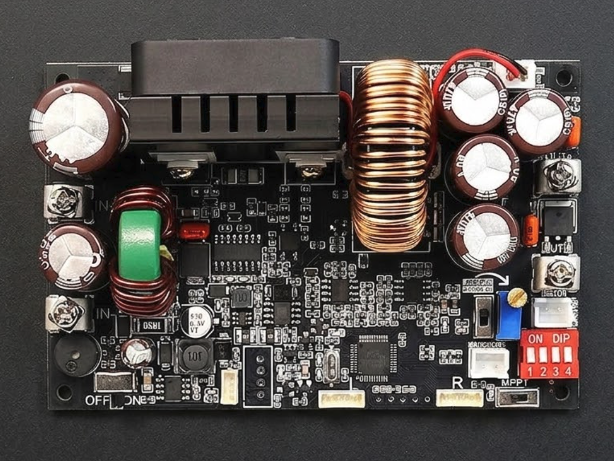

# xy-modbus



`no_std` Modbus-RTU driver for the XY7025 programmable buck converter.

Only tested on real XY7025 hardware; other models share the register layout but
are unverified.

The high-level `Xy` API is intentionally XY7025-specific. The pure framing and
transport layers cover the shared XY-series function codes so other devices can
still be accessed without applying unverified XY7025 scales or limits. The SK
family uses a different 15-register group layout and remains raw-only.

## Usage

```rust,ignore
use xy_modbus::{SafetyLimits, Xy};

let mut xy = Xy::new(my_transport);

xy.set_safety_limits(SafetyLimits { lvp_v: 22.0, ovp_v: 15.0, ocp_a: 15.0 })?;
xy.set_voltage(13.5)?;
xy.set_current_limit(10.0)?;
xy.set_output(true)?;

let s = xy.read_status()?;
```

Call `xy.check_model()?` at boot. The returned `ModelCheck` reports two things
separately, because on real hardware they differ:

- `scales_match` — the fixed-point scales this driver decodes with. Getting
  this wrong silently shifts current and power readings by 10×.
- `limits_match` — the physical ceilings its setters enforce (70 V, 25 A, …).

Only `0x6500` (XY7025) sets both. `0x6100`-class devices share the scales but
have lower ceilings, so readings decode correctly while the setters would
accept values the hardware cannot deliver — use the raw layers for those.
Neither flag proves exact hardware identity.

Register addresses, scales and signedness live in the public `regs` module:
`Reg` names every modelled register and carries its `Encoding`, and `Group`
covers the M0–M9 memory groups. `Xy::read_raw_holding` / `write_raw_holding`
take a bare address, so pass `Reg::TEx.addr()` rather than hard-coding hex.

Only the verified internal temperature sensor is exposed by the high-level API.
The connected external-probe scale is unverified; `Reg::TEx` remains available
through `Xy::read_raw_holding` for explicit bring-up work. It is signed, like
the other temperature registers — decode it as `i16`.

## Transport

The default `embedded-io` feature ships `uart::UartTransport` over any
`uart::BlockingRead + embedded_io::Write` pair. For `esp-idf-hal`, enable
the `esp-idf-hal` feature and use `Xy::from_esp_uart(uart)`.
To bring your own, implement `transport::ModbusTransport` directly. The
`framing` module exposes the on-wire codec, including `response_adu_len` for
transports that must learn a reply's length from its first three bytes, and
`validate_read_slave` / `validate_write_slave` so the address rules are not
reimplemented. Every layer reports `RtuError`; `is_request_error()` separates a
malformed request from a bus fault worth retrying.

The raw framing and UART layers support standard address-`0` FC06/FC10
broadcast writes without waiting for a response. The high-level `Xy` API stays
unicast-only, and broadcast acceptance has not been verified on XY7025.

The transport implementer owns UART timing. The XY-series wants ~50 ms between
frames and a ~500 ms response window; see [`DATASHEET.md`](DATASHEET.md) §2.
The bundled defaults also bound quiet-bus acquisition to ten intervals (about
500 ms) before returning `RtuError::BusBusy`. Custom values use the validated
`uart::UartTiming`; zero-valued parameters are rejected when it is constructed.

## Cargo features

| Feature       | Default | Purpose                                                                       |
| ------------- | ------- | ----------------------------------------------------------------------------- |
| `embedded-io` | yes     | Bundled `uart::UartTransport` over `uart::BlockingRead + embedded_io::Write`. |
| `esp-idf-hal` | no      | `Xy::from_esp_uart` constructor for `esp_idf_hal::UartDriver`.                |
| `defmt`       | no      | `defmt::Format` derives on public types.                                      |

## Boot / safety policy

This crate exposes the device protocol; it intentionally does **not**
prescribe a power-on / fault-recovery policy. See
[`DATASHEET.md`](DATASHEET.md) §7 for the recommended bring-up
checklist (program protection _before_ raising V-SET, force OUTPUT_EN
off until verification passes, etc.).

## References

- [`DATASHEET.md`](DATASHEET.md) — full register map, CRC algorithm,
  wire-level examples, known firmware quirks.
- [ESP32-C6 hardware test](https://github.com/xorza/xy-modbus/tree/master/examples/esp32c6-test)
  — on-device 25-test sweep against a real XY7025 over UART, with exact
  persistent-configuration restoration and a fail-closed output policy.
- API reference on [docs.rs](https://docs.rs/xy-modbus).

## License

Licensed under either of [MIT](LICENSE-MIT) or
[Apache-2.0](LICENSE-APACHE) at your option.
